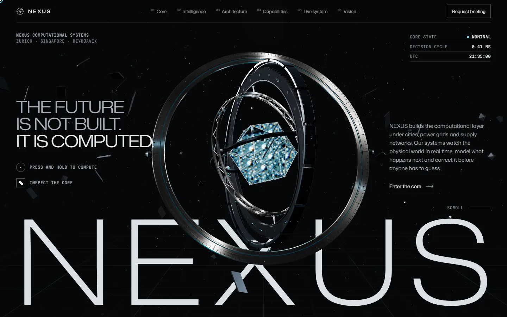
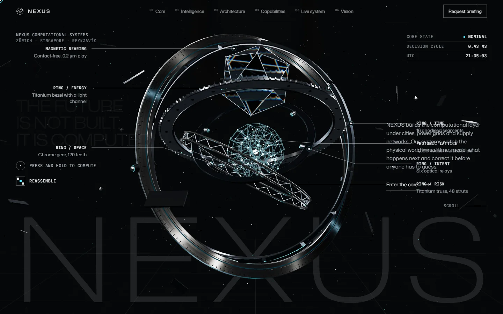
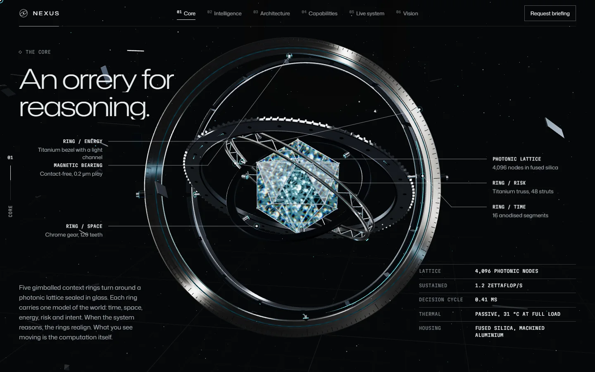
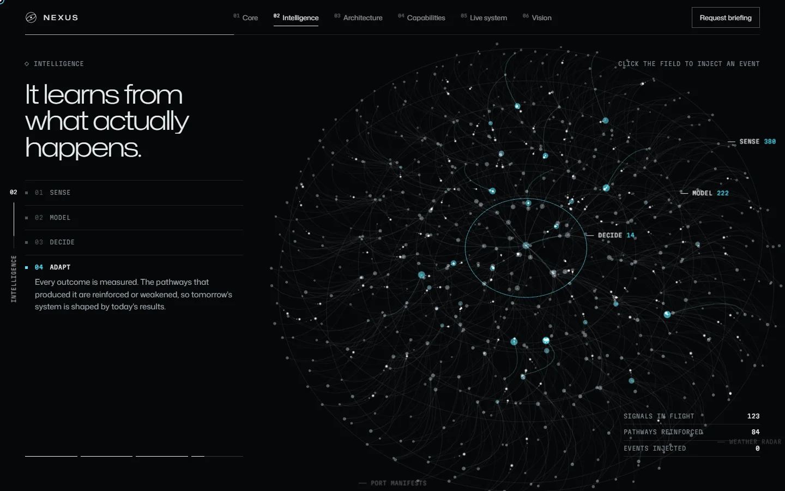
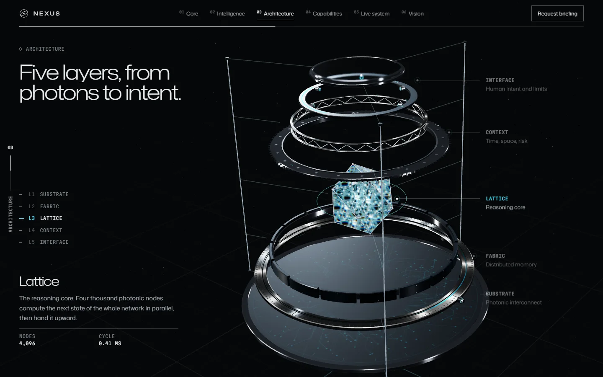
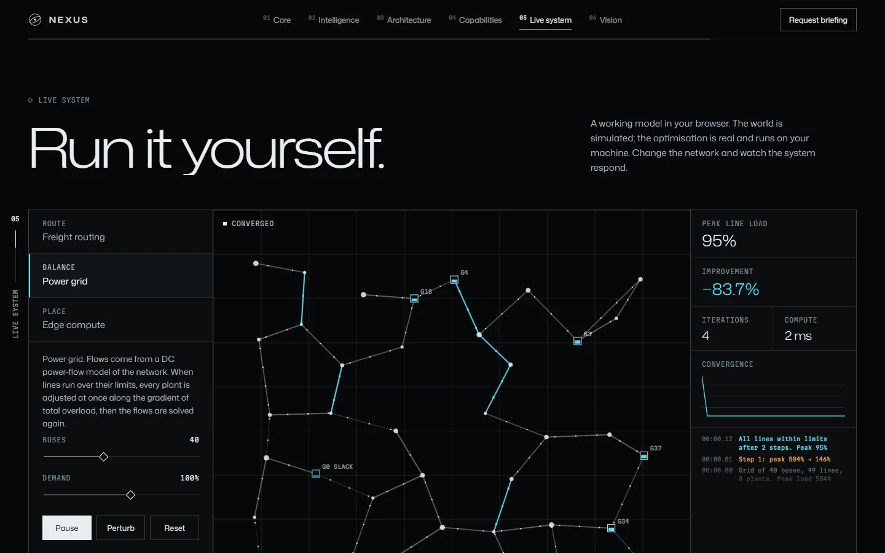

# NEXUS

Concept site for a fictional computational-infrastructure company.

**Live:** https://nexus-chi-eight-45.vercel.app



| | |
|---|---|
|  |  |
|  |  |



Vite + TypeScript, Three.js for the 3D stage, GSAP (ScrollTrigger, SplitText) and Lenis for motion.
No backend; every visual is procedural and every number in the live system is computed in the browser.

```
npm install
npm run dev       # http://localhost:5190
npm run build     # type check + production build to dist/
npm run preview   # serve dist/ on http://localhost:5191
```

## Structure

```
index.html                 all sections, semantic markup
src/main.ts                boot: profile, loader, stage, sections, one ticker
src/core/                  device profile + pointer, Lenis/ScrollTrigger glue
src/gl/
  stage.ts                 renderer, camera poses per section, picking, adaptive pixel ratio
  structure.ts             the core: five engineered rings, glass lattice, bearings, plate, spine
  atmosphere.ts            light shaft and floor grid
  geometry.ts              machined ring profile, brushed/circuit textures
  materials.ts             chrome, brushed aluminium, graphite, glass
  environment.ts           procedural studio lighting (PMREM)
  particles.ts             particle shell and orbiting fragments
  callouts.ts              leader-line labels that follow points on the 3D object
src/sections/              hero, story (scroll -> 3D poses), intelligence, vision, cta, nav, reveals
src/intel/network.ts       Intelligence: 3D network of four shells, loaded on demand
src/viz/                   Grid, Flow, Matter (3D, loaded on demand), Signal (run only while visible)
src/live/                  live console: route (2-opt), balance (DC flow + redispatch), place (k-means)
src/styles/                tokens/base, sections, capabilities, live system, closing
```

## Notes

- One fixed WebGL canvas is shared by hero, core, architecture and the final call to action;
  it stops rendering while hidden.
- Mobile: no transmission glass, fewer particles, lower pixel ratio, different compositions;
  hold-to-compute uses the on-screen button.
- `prefers-reduced-motion`: no smooth scroll, no intro or scrubbed animation, slow 3D motion.
